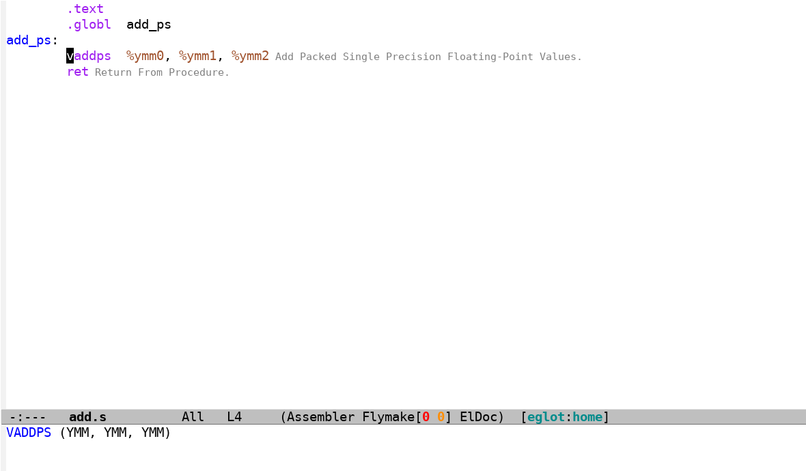
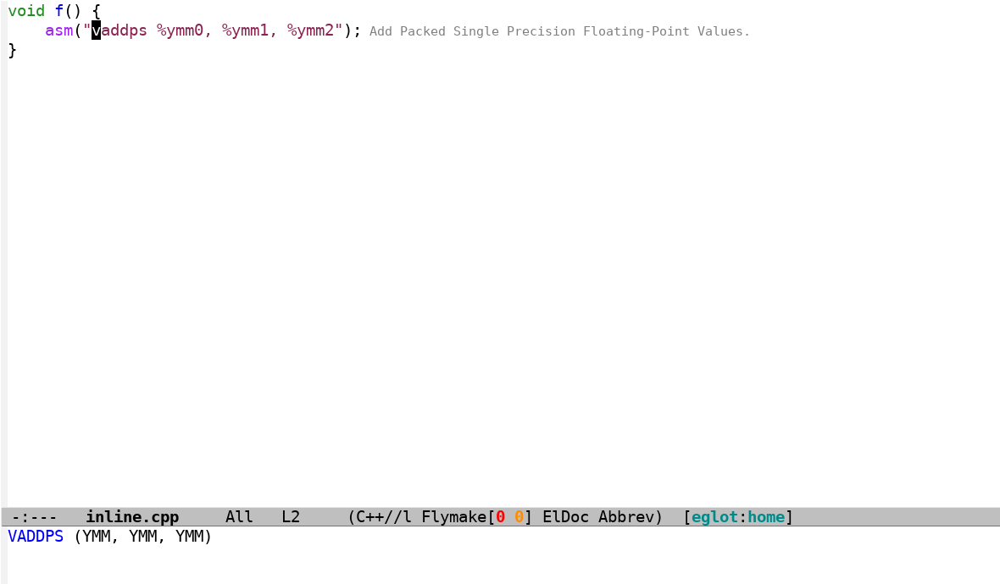

# emacs-simdref

Show the brief of an assembly instruction from the local simdref catalog.

`M-x eglot` on a buffer shows hover docs and inlay hints for instructions.
The catalog is local, so the server answers without network.




## Requirements

- Emacs 29.1 or newer
- `curl` and `tar` for the first install
- Install the `markdown-mode` package so eglot shows the hover text as formatted markdown. Without the package the hover shows raw markdown.

## Setup

```elisp
(add-to-list 'load-path "/path/to/emacs-simdref")
(require 'simdref)
```

The package registers `simdref-lsp` with eglot for `asm-mode`, `nasm-mode`,
`cuda-mode`, `c-mode`, `c++-mode`, `c-ts-mode` and `c++-ts-mode`. When
lsp-mode is loaded, it registers the server there too.

## First start

Without a server on `PATH`, the package installs one in the background to
`(locate-user-emacs-file "simdref/")`. It downloads a pinned `uv`, installs
`simdref`, `rass` and the catalog. This takes minutes and never blocks Emacs.
`M-x eglot` during the install starts nothing and shows this error:

```
Installing simdref in the background.  Run M-x eglot again when the log says the install is done.
```

When the echo area shows `simdref: install done, run M-x eglot`, run
`M-x eglot` again.

Once a day the package upgrades that copy and refreshes the catalog. A
new simdref version takes effect at the next server start. A server on
`PATH` is never upgraded.

Set `simdref-install-dir` to move the private install.

## C, C++ and CUDA buffers

In a C, C++ or CUDA buffer, simdref and clangd run together. The
rassumfrassum multiplexer (`rass`) runs the two servers for one eglot
connection. lsp-mode runs simdref as an add-on client with clangd and
no multiplexer.

The companion server is the `simdref-companion-server` command list.
The default is `("clangd")`. Set it to nil to run simdref alone. The
first element of the list must be on `exec-path`. Assembly buffers run
simdref alone.

Hover on an asm string shows the simdref instruction text. Hover on a
C++ name shows nothing: the rassumfrassum multiplexer sends hover to
its first server only.

A new simdref or rass version takes effect at the next server start.

## Logging

Maintenance never opens a window. Success lines go to the `*simdref-log*`
buffer only. A failure (nonzero exit, timeout kill, missing executable,
sha mismatch) logs to that buffer and shows one echo-area line that
starts with `simdref:` and names the step that failed. The missing-server
notice prints once per Emacs session. A failed install shows for example:

```
simdref: simdref-lsp not found; curl -fsSL ... failed: exit 6
```

## Test

```sh
podman build -t emacs-simdref-test -f test/podman/Containerfile .
podman run --rm --network none -v "$PWD:/src:ro,Z" emacs-simdref-test
```

The suite drives `simdref-maintain` with fake `uv`, `isa`, `rass` and
`simdref-lsp` scripts. It needs no network: the install test fetches a
staged uv release from a `file://` URL. Mutation results live in
`test/MUTATIONS.md`.

## License

GPL-3.0-or-later. See LICENSE.
